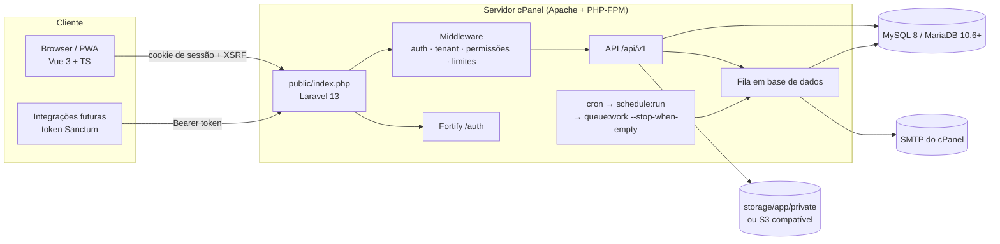

# B. Arquitetura técnica

## 1. Decisão geral

**Monólito modular Laravel**, com API REST versionada (`/api/v1`) e uma SPA Vue 3 servida pela mesma aplicação, no mesmo domínio.

Porque não microserviços nem frontend separado: o alojamento-alvo é cPanel. Um único deploy, um único domínio, uma única base de dados MySQL e sessões por cookie simplificam o SSL, o CORS, a segurança e a operação. A separação em módulos dentro do código permite extrair serviços mais tarde, se o volume o justificar.



## 2. Tecnologias e justificação

| Camada | Escolha | Justificação |
| --- | --- | --- |
| Linguagem | PHP 8.3+ | Suportado pelo MultiPHP do cPanel (EasyApache 4). Laravel 13 exige 8.3 |
| Framework | Laravel 13 | Versão estável atual, ecossistema maduro, migrações, filas, agendador, políticas, validação |
| Autenticação | Laravel Fortify (headless) + Sanctum | Fortify trata login, recuperação de password, verificação de email e 2FA TOTP com código auditado pela comunidade. Sanctum dá sessão por cookie à SPA (sem tokens no `localStorage`) e tokens para integrações |
| Autorização | RBAC próprio sobre o Gate do Laravel | Permissões `modulo.acao` guardadas em BD, perfis por empresa, âmbito de obra preparado |
| Base de dados | MySQL 8.0+ ou MariaDB 10.6+ | É o que o cPanel oferece. Esquema compatível com ambos (testado em MariaDB 10.11 e SQLite) |
| Fila | Driver `database` | Não exige Redis. Em VPS troca-se para `redis` só no `.env` |
| Cache / sessões | Driver `database` | Idem |
| Armazenamento | Disco `private` (local) ou `s3` | Ficheiros fora de `public/`; servidos por controlador com verificação de permissões ou URL temporário assinado |
| Frontend | Vue 3 + TypeScript + Vue Router + Pinia + Tailwind CSS 4 | Pedido no prompt; componentes reutilizáveis; compilado com Vite antes do envio |
| PWA | Manifesto + service worker próprio | Instalável. Cache do shell da aplicação. Offline de escrita na fase 2 |
| Testes | PHPUnit (backend), `vue-tsc` (tipos do frontend) | Correm em CI com MySQL 8 |
| CI | GitHub Actions | Testes em MySQL, compilação do frontend e ZIP de release como artefacto |

## 3. Restrições do cPanel e como são resolvidas

| Restrição | Solução |
| --- | --- |
| Sem Node.js no servidor | O ZIP de release já inclui `public/build` compilado e `vendor/` |
| Sem SSH em alguns planos | SQL importável no phpMyAdmin (`database/sql/`) + página `/instalar` protegida por token para criar o primeiro administrador |
| Sem supervisor / processos permanentes | `* * * * * php artisan schedule:run`. O agendador lança `queue:work --stop-when-empty --max-time=50` sem sobreposição |
| Sem Redis | Cache, sessões e filas em base de dados |
| `public_html` como raiz fixa | Apontar a raiz do domínio para `obraconnect/public` (cPanel → Domínios) ou usar o `index.php` adaptador em `deploy/cpanel/` |
| Symlinks desativados | Não se usa `storage:link`; ficheiros privados nunca passam por `public/` |
| Limites de upload do PHP | Configuráveis no "MultiPHP INI Editor"; upload multipart por blocos chega na fase 2 |
| Quota de disco | Disco S3 compatível configurável desde a fase 1 |

## 4. Estrutura lógica do código

```
app/
  Access/        Catálogo de permissões, modelos de perfis, resolução de permissões
  Audit/         Registo de auditoria (append-only)
  Billing/       Planos, limites e funcionalidades por subscrição
  Tenancy/       Contexto da empresa, âmbito global, trait BelongsToTenant
  Support/       Utilitários (validador de NIF, etc.)
  Actions/       Casos de uso (registar empresa, convidar utilizador, ...)
  Models/        Modelos Eloquent
  Policies/      Regras por recurso
  Http/
    Controllers/Api/V1/          API da empresa
    Controllers/Api/V1/Platform/ Backoffice global
    Middleware/                  tenant, plataforma, só-leitura, cabeçalhos de segurança
    Requests/                    Validação
    Resources/                   Formato das respostas JSON
  Jobs/          Trabalhos em fila (conscientes da empresa)
  Console/       Comandos (sincronizar permissões, varrer subscrições, criar admin)
resources/js/    SPA Vue (ver docs/04-modulos.md)
database/
  migrations/    Migrações Laravel
  sql/           SQL completo para importar no phpMyAdmin
deploy/cpanel/   Ficheiros específicos do cPanel
```

## 5. Multi-tenancy

Modelo: **base de dados partilhada, esquema partilhado, coluna `tenant_id`** em todas as tabelas de dados de empresa.

Porque este modelo: funciona num único utilizador MySQL de cPanel, migrações correm uma vez, custo baixo por cliente. Bases dedicadas ficam preparadas para clientes Enterprise (ver 5.5).

### 5.1 Resolução da empresa ativa

1. O utilizador autentica-se (sessão Sanctum ou token).
2. O middleware `tenant` lê `users.current_tenant_id`. **Nunca** lê o tenant de cabeçalhos, parâmetros ou corpo do pedido.
3. Confirma que existe `memberships` ativa para esse par utilizador/empresa. Se não existir, escolhe a primeira associação ativa ou devolve 403.
4. Confirma o estado da empresa: `active` passa; `read_only` só permite leitura; `suspended` devolve 423.
5. Se a empresa exigir 2FA e o utilizador não o tiver ativo, devolve 403 com código `MFA_REQUIRED`.
6. Guarda empresa + associação no `TenantContext` (singleton por pedido) e no `Context` do Laravel.

Trocar de empresa: `POST /api/v1/me/tenants/{id}/switch`, que valida a associação antes de alterar `current_tenant_id`, e fica auditado.

### 5.2 Isolamento nas consultas

- Os modelos com dados de empresa usam o trait `BelongsToTenant`:
  - âmbito global que acrescenta `WHERE tenant_id = ?` a todas as consultas;
  - preenche `tenant_id` automaticamente ao criar;
  - impede alterar `tenant_id` de um registo existente;
  - **falha fechado**: sem empresa no contexto, qualquer consulta ou criação lança `MissingTenantContextException`. Uma consulta acidental sem contexto nunca devolve dados de todas as empresas.
- Operações globais legítimas (comandos de plataforma, varrimento de subscrições) usam explicitamente `TenantContext::runWithoutTenant()` ou `runAs($tenant)`, que ficam visíveis em revisão de código.
- Chaves únicas incluem `tenant_id` (ex.: `UNIQUE(tenant_id, key)` nos perfis).
- **Chaves estrangeiras compostas** nas relações críticas: por exemplo `memberships(tenant_id, role_id) → roles(tenant_id, id)`. A própria base de dados recusa associar um utilizador a um perfil de outra empresa, mesmo que um bug passe pela aplicação.
- Validação de IDs recebidos (ex.: `role_id`) é feita com `Rule::exists` filtrado pela empresa ativa.

### 5.3 Filas, relatórios e notificações

O `TenantContext` escreve o ID da empresa no `Context` do Laravel, que é serializado com cada trabalho em fila. Ao processar o trabalho, o contexto é restaurado antes de o código correr. Um trabalho criado sem empresa corre sem empresa e, se tocar em modelos de empresa, falha fechado.

### 5.4 Ficheiros

Caminho: `tenants/{tenant_id}/{módulo}/...` no disco `private` ou `s3`. O download passa sempre por um controlador que resolve o registo através do modelo (logo, filtrado pela empresa) ou por URL temporário assinado de curta duração.

### 5.5 Caminho para bases dedicadas

A tabela `tenants` tem a coluna `database_connection` (nula = base partilhada). Na fase 6, o middleware passa a trocar a ligação por omissão quando essa coluna estiver preenchida. Como todas as tabelas já têm `tenant_id`, mover uma empresa é exportar as suas linhas e importá-las na base dedicada.

## 6. Autorização

- **Permissões**: catálogo em código (`app/Access/PermissionRegistry.php`), sincronizado para a tabela `permissions` com `php artisan obraconnect:sync-permissions`. Formato `modulo.acao` (ex.: `users.invite`).
- **Perfis**: por empresa (`roles.tenant_id`). Ao criar a empresa, os 14 perfis-modelo são copiados e podem ser editados. O perfil `admin` está bloqueado com todas as permissões.
- **Associação**: cada `membership` tem um perfil.
- **Âmbito de obra** (fase 2): `project_members` permite um perfil diferente numa obra específica; o serviço `AccessResolver::can($membership, $permission, $project)` já aceita o argumento.
- **Integração com o Laravel**: `Gate::before` resolve qualquer chave do catálogo, por isso os controladores usam `$this->authorize('users.invite')`. Políticas tratam regras por recurso (ex.: não remover o último administrador).
- **Plataforma**: `users.platform_role` (`super_admin`, `support`, `billing`). Rotas `/api/v1/platform/*` exigem esse papel **e** 2FA ativo.

## 7. Acesso do suporte técnico

1. O administrador da empresa cria uma autorização (`support_access_grants`) com motivo e duração (1 a 72 h).
2. O suporte vê as autorizações ativas e "entra" numa delas. A sessão guarda o ID da autorização.
3. Enquanto a autorização for válida, o middleware `tenant` monta o contexto dessa empresa em **modo só leitura**: qualquer pedido que não seja GET/HEAD é recusado.
4. Cada pedido feito em modo suporte fica auditado com `actor_type = support`.
5. A empresa pode revogar a autorização a qualquer momento; o acesso termina no pedido seguinte.

## 8. Subscrições e limites

- `plans.limits` (JSON) e `plans.features` (JSON) são editáveis no backoffice. Exemplo: `{"max_users": 10, "max_active_projects": 3, "storage_mb": 5120}`.
- `subscriptions.custom_limits` sobrepõe-se aos limites do plano (clientes Enterprise).
- `PlanLimits::assertCanAdd($tenant, 'max_users')` é chamado antes de criar recursos limitados; devolve 402 com código `PLAN_LIMIT_REACHED`.
- O comando agendado `obraconnect:subscriptions-sweep` (diário) aplica o ciclo trial → só leitura → suspensão. Os prazos estão em `config/obraconnect.php`.

## 9. Auditoria

- Tabela `audit_logs` append-only: o modelo recusa `update` e `delete`.
- Regista: autenticação (sucesso, falha, logout, recuperação de password), alterações de empresa, associações, perfis, convites, subscrições, acessos de suporte, exportações e ações de plataforma.
- Campos sensíveis (`password`, `remember_token`, segredos 2FA, tokens) nunca são gravados.
- Cada pedido tem um `X-Request-Id`, gravado no registo e devolvido na resposta.

## 10. Segurança (resumo)

Detalhe em `docs/10-checklist-seguranca.md`.

- HTTPS forçado em produção (`FORCE_HTTPS=true`) e HSTS.
- Cookies `Secure`, `HttpOnly`, `SameSite=Lax`; sessão encriptada.
- CSRF pela cookie `XSRF-TOKEN` do Sanctum.
- Cabeçalhos: CSP, `X-Frame-Options: DENY`, `X-Content-Type-Options`, `Referrer-Policy`, `Permissions-Policy`.
- Rate limiting no login, 2FA, registo, convites e API.
- Passwords com mínimo de 10 caracteres, letras e números; verificação contra fugas conhecidas (HIBP) ativável por `.env`.
- 2FA TOTP com códigos de recuperação; obrigatório para a equipa da plataforma e configurável por empresa.
- Segredos só em `.env` (fora de `public/`).

## 11. Observabilidade

- Logs diários em `storage/logs` (canal `daily`, 14 dias).
- `GET /up` (saúde do Laravel) e `GET /api/v1/health` (versão, ligação à BD).
- Integração com Sentry ou similar fica preparada por variável de ambiente na fase 6.

## 12. Evolução para VPS/cloud

Ver `docs/09-migracao-vps.md`. Resumo: trocar `QUEUE_CONNECTION`, `CACHE_STORE` e `SESSION_DRIVER` para `redis`, correr `queue:work` com supervisor, mover ficheiros para S3. Nenhuma alteração de código.
