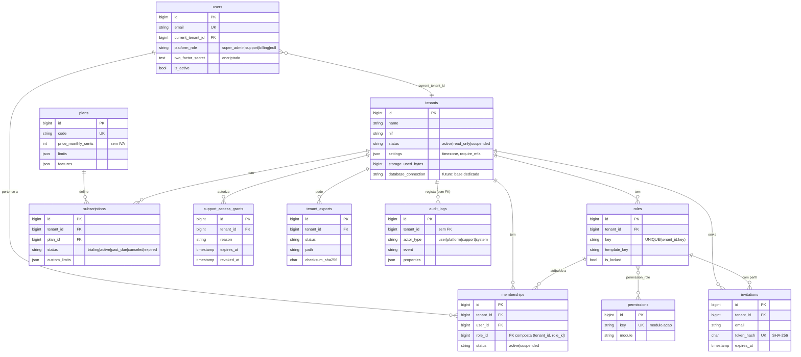

# C. Modelo relacional de dados

Duas partes: (1) o esquema **implementado** na fase 1, com migrações e testes; (2) o modelo **lógico completo** do produto, que orienta as fases seguintes. As tabelas da parte 2 ainda não existem.

## Convenções

- Chaves primárias `id BIGINT UNSIGNED AUTO_INCREMENT`.
- Todas as tabelas com dados de empresa têm `tenant_id` (FK para `tenants`) e usam o trait `BelongsToTenant`.
- Unicidade sempre com `tenant_id` à cabeça (ex.: `UNIQUE(tenant_id, code)`).
- Relações críticas dentro da empresa usam **FK composta** `(tenant_id, x_id) → x(tenant_id, id)`, com `UNIQUE(tenant_id, id)` na tabela de destino.
- `created_at`/`updated_at` em todas as tabelas; `deleted_at` (soft delete) onde há obrigação de histórico.
- Estados como `VARCHAR(20)` + enum PHP (evita `ALTER TABLE` para acrescentar estados).
- Valores monetários em cêntimos (`BIGINT`), quantidades em `DECIMAL(14,3)`.
- JSON só para configuração e metadados, nunca para dados que precisem de filtros ou relações.
- Charset `utf8mb4`, colação `utf8mb4_unicode_ci`.

## 1. Esquema implementado (fase 1)

### Tabelas e regras

| Tabela | Âmbito | Notas | Eliminação |
| --- | --- | --- | --- |
| `users` | Global | Identidade. Password com bcrypt. Segredos 2FA encriptados com `APP_KEY` | Manual; associações em cascata |
| `tenants` | Global | Empresa. `status` controla acesso. `deleted_at` (soft delete) | Soft delete; purga em procedimento próprio |
| `plans` | Global | Editável no backoffice. Nunca apagado | `RESTRICT` a partir de `subscriptions` |
| `subscriptions` | Global (gerida pela plataforma) | Histórico: a mais recente é a atual | Cascata com a empresa |
| `permissions` | Global | Sincronizada a partir de `PermissionRegistry` | — |
| `roles` | Empresa | Copiados de `RoleTemplates`. `admin` bloqueado | Cascata com a empresa; app impede apagar perfis em uso |
| `permission_role` | Empresa (via perfil) | Pivô | Cascata |
| `memberships` | Empresa | `UNIQUE(tenant_id, user_id)`; FK composta para o perfil | Cascata com empresa ou utilizador |
| `invitations` | Empresa | Só o hash do token; validade 7 dias | Cascata |
| `audit_logs` | Empresa ou plataforma | Append-only; sem FK para sobreviver à remoção de utilizadores | Por política de retenção |
| `support_access_grants` | Empresa | Máx. 72 h, só leitura | Cascata |
| `tenant_exports` | Empresa | Ficheiro expira em 48 h | Cascata; ficheiro apagado por comando agendado |
| `sessions`, `cache*`, `jobs`, `failed_jobs`, `password_reset_tokens`, `personal_access_tokens` | Infraestrutura Laravel | Necessárias em cPanel (drivers em BD) | Limpeza agendada |

### Índices principais

- `memberships(user_id, status)` — resolução da empresa ativa em cada pedido.
- `audit_logs(tenant_id, created_at)` — listagem da auditoria por empresa.
- `subscriptions(tenant_id, status)` e `(status, trial_ends_at)` — varrimento diário.
- `invitations(token_hash)` único — aceitação de convites.

## 2. Modelo lógico completo (fases 2 a 6)

Todas as tabelas abaixo levam `tenant_id`, `created_at`, `updated_at` e, quando indicado, `created_by_user_id`.

### Estrutura da empresa (fase 2)

**Implementado na 0.8.0:** `clients` (type, name, nif único por empresa, country_code, contactos, morada, notes, archived_at), `work_calendars` (name, `weekly_hours` JSON com chaves ISO "1"…"7", `is_default` — um por empresa, garantido pela aplicação) e `holidays` (work_calendar_id, date, name, kind nacional/facultativo/municipal/empresa; `UNIQUE(work_calendar_id, date)`). `projects` ganhou `client_id` e `work_calendar_id` com FKs compostas sem "set null" (a aplicação recusa apagar clientes e calendários com obras). **Implementado na 0.9.0:** `departments` (name único por empresa, description), `memberships.department_id` (FK composta; ao apagar o departamento a aplicação limpa-o primeiro), `cost_centers` (code único por empresa — sem distinguir maiúsculas, verificado na aplicação —, name, parent_id com auto-FK composta, archived_at) e `projects.cost_center_id`. **Implementado na 0.10.0:** `specialties` (code até 10 caracteres, único por empresa sem distinguir maiúsculas — verificado na aplicação —, name, sort_order, archived_at) e `specialty_id` (FK composta, sem "set null") em `construction_elements` e `documents`. Lista habitual em `App\Models\Specialty::DEFAULTS`, criada no registo da empresa.

| Tabela | Campos principais | Relações |
| --- | --- | --- |
| `departments` | name | — |
| `cost_centers` | code, name, parent_id | auto-relação |
| `work_calendars` | name, weekly_hours (JSON por dia) | — |
| `holidays` | calendar_id, date, name, scope (nacional/municipal) | calendário |
| `clients` | type (particular/empresa/público), name, nif, contactos | — |
| `specialties` | code, name (estruturas, AVAC, eletricidade...) | — |

### Obras (fase 2)

**Implementado na 0.2.0:** `projects` (sem `client_id`, `lat/lng` e `contract_days`, que chegam com clientes e planeamento), `project_members` (FKs compostas para obra, associação e perfil; `memberships` ganhou `UNIQUE(tenant_id, id)`), `site_diary_entries` (`UNIQUE(tenant_id, project_id, entry_date)`, estado rascunho/submetido) e `site_diary_items`. As linhas do diário usam colunas próprias (`kind`, `description`, `quantity DECIMAL(14,3)`, `unit`, `company`) em vez de `payload` JSON, para poderem ser filtradas e somadas.

| Tabela | Campos principais | Relações |
| --- | --- | --- |
| `projects` | code, name, client_id, owner_name, type, address, lat, lng, contract_value_cents, initial_budget_cents, starts_on, planned_end_on, contract_days, status, deleted_at | cliente |
| `project_members` | project_id, membership_id, role_id (perfil na obra) | FK compostas |
| `project_contract_revisions` | project_id, number, value_delta_cents, days_delta, reason, approved_at | obra |
| `buildings` → `floors` → `zones` (**0.5.0:** uma só tabela `project_locations` com `kind` e auto-relação composta) | project_id / building_id / floor_id, name, sort_order | hierarquia |
| `construction_elements` (**0.5.0:** com `location_id` para qualquer nível, `code` único na obra; `specialty_id` fica para as especialidades) | zone_id, element_type (sapata, pilar, viga, laje, parede...), code, name, specialty_id | zona |
| `activities` | project_id, element_id (opcional), wbs_code, name, unit, planned_qty, status | elemento |
| `activity_dependencies` | predecessor_id, successor_id, type (FS/SS/FF/SF), lag_days | atividades |
| `schedules` | project_id, version, is_baseline, created_at | obra |
| `schedule_items` | schedule_id, activity_id, start, finish, optimistic/likely/pessimistic (PERT), is_critical, float_days | versão |
| `site_diary_entries` | project_id, date, weather (JSON), notes, submitted_at, submitted_by | obra; `UNIQUE(project_id, date)` |
| `site_diary_items` | entry_id, kind (equipa, equipamento, material, incidente, visita), payload JSON | diário |

### Documentos e media (fase 2)

**Implementado na 0.4.0:** `document_folders` (auto-relação composta `(tenant_id, parent_id)`; só se apagam vazias), `documents` (sem `current_version_id`: a atual é a versão de número mais alto; sem `specialty_id` e etiquetas, que chegam com as especialidades), `document_versions` (`UNIQUE(document_id, number)`, imutáveis, `sha256`, `mime` pelo conteúdo) e `document_downloads` (o `download_logs` do modelo). Sem antivírus: os ficheiros nunca são executados nem servidos como HTML (só PDF e imagens abrem no browser; o resto vai como `application/octet-stream`).

**Implementado na 0.3.0:** `media` só para fotografias do diário. Em vez de `attachables` polimórfico, cada dono tem a sua coluna com FK composta (hoje `diary_entry_id`), para a base de dados garantir que a fotografia é da mesma empresa e obra. Colunas: `original_path` (intacto), `preview_path` e `thumb_path` (JPEG gerados em fila), `sha256`, `size_bytes` + `derived_bytes` (somados a `tenants.storage_used_bytes`), `width`/`height` depois da orientação EXIF, `taken_at`, `caption`, `status` (processing/ready/failed). EXIF e GPS não são guardados à parte.

| Tabela | Campos principais |
| --- | --- |
| `folders` | project_id, parent_id, name |
| `documents` | project_id, folder_id, title, specialty_id, current_version_id, tags (via pivô) |
| `document_versions` | document_id, number, disk, path, size, mime, sha256, uploaded_by, antivirus_status |
| `media` | project_id, kind (foto/vídeo), original_path, preview_path, sha256, taken_at, gps (opcional), exif JSON |
| `attachables` (**0.6.0:** substituído por `location_id`/`element_id` com FK composta em `site_diary_items`, `media` e `documents`) | media_id/document_id, attachable_type, attachable_id (liga a tarefas, inspeções, ocorrências, elementos) |
| `download_logs` | document_version_id, user_id, ip, created_at |

O original de cada fotografia é guardado sem alterações (hash SHA-256 registado) e as versões otimizadas ficam noutro caminho.

### Fiscalização e qualidade (fase 3)

**Implementado na 0.11.0:** `checklist_templates` (name único por empresa, specialty_id, version, archived_at) e `checklist_template_items` (text, guidance, requires_photo, min_photos, requires_measure, measure_unit, measure_min, measure_max — as `evidence_requirements` ficaram nestas colunas); `inspections` (number único por obra, title, checklist_template_id + template_version, reinspection_of_id, location_id/element_id, specialty_id, status com os 9 estados de `App\Enums\InspectionStatus`, remote, scheduled_for, quem pediu/fez/decidiu e quando, decision_note, evidence_score — o `evidence_scores` ficou nesta coluna, gravada na submissão); `inspection_items` (cópia dos pontos + result ok/nok/na, measure_value, notes); `inspection_events` (substitui `inspection_decisions`: uma linha por passo, sequence, action, from/to_status, user_id e user_name copiado, reason, payload em JSON canónico, prev_hash, hash; sem FK para users e sem updated_at — o modelo recusa alterar e apagar); `media.inspection_item_id` (FK composta) para as fotografias de evidência. Todas as ligações com FK composta e sem "set null".

**Implementado na 0.12.0:** pontos de paragem em `checklist_templates.hold_point` e `inspections.hold_point` + `hold_released_at`/`hold_released_by_user_id` (sem atividades ainda: o ponto de paragem é da inspeção; a tabela `hold_points` fica para quando houver planeamento); `issues` (number único por obra, kind nonconformity/occurrence, severity minor/major/critical, status open/in_progress/resolved/closed/cancelled, local/elemento, specialty_id, inspection_id + inspection_item_id, **assignee_user_id** — utilizador da equipa, em vez de membership/subempreiteiro —, due_on, escalated_at, resolution_note, quem resolveu/fechou e quando); `issue_events` (created, comment, start, resolve, close, reopen, cancel, assigned, due_changed, escalated; user_name copiado; só se acrescenta); `media.issue_id`.

**Implementado na 0.13.0:** `approvals_required` (1 a 3) em `checklist_templates` e `inspections`. A tabela genérica `approvals` não foi criada: as aprovações de uma inspeção são as linhas `approve`/`approve_with_reservations` do `inspection_events` depois da última `submit` (com `payload.step`/`payload.of`), já protegidas pela cadeia de hashes.

| Tabela | Campos principais |
| --- | --- |
| `checklist_templates` | name, specialty_id, version, is_active |
| `checklist_template_items` | template_id, text, requires_photo, requires_measure, is_hold_point |
| `inspections` | project_id, element_id, activity_id, template_id, status (9 estados), requested_by, inspector_membership_id, scheduled_for, remote |
| `inspection_items` | inspection_id, template_item_id, result (ok/nok/na), measure_value, notes |
| `inspection_decisions` | inspection_id, decision, decided_by, reason, signature_ref, prev_hash, hash (cadeia imutável) |
| `evidence_requirements` | template_item_id, kind, min_count, orientation_hint |
| `evidence_scores` | inspection_id, score, criteria JSON (índice de suficiência, explicável) |
| `hold_points` | activity_id, inspection_id, released_at, released_by |
| `issues` (ocorrências / NC) | project_id, number (`UNIQUE(tenant_id, project_id, number)`), location, specialty_id, description, priority, severity, assignee_membership_id, assignee_subcontractor_id, due_on, status, closed_at, validated_by |
| `issue_events` | issue_id, type (comentário, mudança de estado, escalonamento), payload |
| `approvals` | approvable_type, approvable_id, step, approver_membership_id, decision, decided_at |
| `comments` | commentable_type, commentable_id, body, author_id |

### Gestão económica (fase 4)

**Implementado na 0.14.0** (todas as ligações com FK composta `(tenant_id, x_id)`; nada usa "set null"; com referências, apaga-se com erro `*_IN_USE` ou arquiva-se):

| Tabela | Campos principais |
| --- | --- |
| `resources` (biblioteca) | kind (labor/material/equipment/subcontract), code único, name, unit, unit_cost_cents, archived_at |
| `articles`, `article_components` | code único, description, unit, unit_cost_cents (cache), notes, archived_at; componentes: resource_id + quantity (rendimento) |
| `budgets` | project_id, code, name, version, status (draft/approved/superseded), vat_mode (normal/reverse_charge/exempt), vat_rate, overhead_pct, profit_pct, revision_of_id, approved_by/at |
| `budget_chapters` | budget_id, parent_id (subcapítulos, cascata), code, name, sort_order |
| `budget_items`, `budget_item_components` | chapter_id, article_id, specialty_id, code, description, unit, quantity, unit_cost_cents, unit_price_cents (vazio = calculado); componentes copiados (kind, name, unit, quantity, unit_cost_cents) |
| `measurements` | project_id, budget_item_id, measured_on, description, count/length/width/height, quantity, location_id/element_id, certificate_id |
| `certificates`, `certificate_lines` | scope ('owner' ou 'contract:{id}'), number único por obra e âmbito, period_start/end, status (draft/submitted/approved), amount_cents, retention_cents; linhas: qty_contract, qty_previous, qty_period, unit_price_cents, amount_cents |
| `partners`, `partner_specialty`, `partner_documents` | kind (supplier/subcontractor), name, nif único, contactos, archived_at; documentos com expires_on |
| `contracts`, `contract_items` | project_id, partner_id, code, title, retention_pct, starts_on/ends_on, status (draft/active/closed); trabalhos com quantity e unit_price_cents |
| `purchase_orders`, `purchase_order_lines` | number por obra, partner_id, status (draft/approved/received/invoiced/cancelled), category (natureza), cost_center_id, datas, fatura (número, data, valor); linhas com resource_id e budget_item_id |
| `cost_entries` | project_id, cost_center_id, category, kind (committed/actual), description, amount_cents, incurred_on (só os lançamentos manuais: compras, autos, horas e equipamentos contam a partir das suas tabelas) |
| `projects.cost_ceiling_cents` | teto de custo (vazio = custo do orçamento aprovado) |
| `workers` | name, nif (encriptado), category, hourly_cost_cents, partner_id, user_id, active |
| `time_entries` | worker_id + project_id + work_date únicos, activity_id, hours, overtime_hours, hourly_cost_cents (cópia do dia), status (pending/approved/rejected), approved_by/at |
| `equipment`, `equipment_usages`, `maintenance_records` | code único, qr_token único, status, project_id (onde está), hourly_cost_cents; utilizações com horas e custo/hora do dia; manutenções com next_due_on |
| `activities`, `activity_dependencies` | parent_id (resumos), code único por obra, duration_days (úteis), PERT (otimista, provável, pessimista), start_no_earlier_than, progress_pct, completed_at, local/elemento; dependências FS/SS/FF/SF com lag_days |
| `inspections.activity_id` | liga a inspeção (e o ponto de paragem) a uma atividade |

Não foram criadas: `price_records` (histórico de preços), `materials`/`labor_categories` separados (ficaram em `resources.kind`), e as horas de entrada/saída e a localização em `time_entries`.

**Implementado na 0.15.0 (pré-faturação):**

| Tabela | Campos principais |
| --- | --- |
| `invoice_drafts` | project_id, client_id e certificate_id (opcionais, FK composta), series_year + number (internos, únicos por empresa, dados quando fica pronta), status (draft/ready/invoiced/cancelled), issue_date, due_date, cópia dos dados do cliente (nome, NIF, morada, código postal, localidade, país, email), reference, vat_exemption_code/reason, notes, ready_at, official_number + official_date (fatura do programa certificado), invoiced_at/by |
| `invoice_draft_lines` | invoice_draft_id (cascata), code, description, unit, quantity, unit_price_cents, discount_pct, vat_rate, sort_order |

**Implementado na 0.16.0 (faturas e guias de fornecedores):**

| Tabela | Campos principais |
| --- | --- |
| `supplier_documents` | project_id, partner_id, purchase_order_id, cost_entry_id, cost_center_id (opcionais, FK compostas sem set null), kind (invoice/credit_note/receipt/delivery_note/other), status (reading/to_review/posted/rejected), category; ficheiro (disk, path, original_name, mime, size_bytes, sha256 único por empresa); leitura (reader, reader_document_id, confidence, review_reasons, read_error, read_at, lines em JSON só para consulta); dados (supplier_name, supplier_nif, customer_nif, number, atcud, issue_date, due_date, order_reference, net/vat/gross_cents, notes); posted_at/by |

`cost_entries` ganhou a chave única (tenant_id, id) para a FK composta.

### Inteligência e automação (fase 5)

Histórico e alertas (0.18.0): `forecast_snapshots` (uma linha por obra e por semana — segunda-feira —, atualizada todos os dias pelo `obraconnect:forecast-watch`) e `project_alerts` (alertas automáticos; `open_key` único só enquanto aberto; `project_id` vazio = alerta da empresa). As regras ficam em `tenants.settings.alerts`.

As previsões explicadas (0.17.0) não têm tabelas: calculam-se no momento a partir do orçamento aprovado, das medições, dos movimentos de custo (`App\Economics\CostReport::movements`) e do planeamento (`App\Forecasting\CostForecast` e `ScheduleForecast`). As tabelas abaixo são as previstas para a IA generativa e as automações.

| Tabela | Campos principais |
| --- | --- |
| `ai_usage` | user_id, feature, provider, model, tokens_in, tokens_out, cost_micros, created_at |
| `ai_document_chunks` | document_version_id, chunk_index, content_hash, embedding_ref (vetores fora do MySQL se necessário) |
| `automation_rules` | trigger, conditions JSON, actions JSON, is_active |
| `notifications` (Laravel) + `notification_preferences` | canal, frequência, limites de envio |

### Comercialização e integrações (fase 6)

| Tabela | Campos principais |
| --- | --- |
| `coupons`, `coupon_redemptions` | code, percent_off/amount_off, max_redemptions, valid_until |
| `invoices` (subscrições) | tenant_id, number externo (software certificado), amount_cents, status, paid_at |
| `payment_methods` | provider, provider_ref (sem dados de cartão) |
| `integrations` | provider, status, credentials (encriptado), settings |
| `webhooks`, `webhook_deliveries` | url, secret (encriptado), events, last_status |
| `platform_announcements` | title, body, audience, starts_at, ends_at |
| `support_tickets` | tenant_id, subject, status, priority |

## 3. Retenção (proposta, a validar juridicamente)

| Dados | Retenção proposta |
| --- | --- |
| Auditoria | 5 anos (segurança e prova); purga anual do que excede |
| Logs técnicos | 14 dias |
| Exportações | 48 h |
| Convites aceites/expirados | 12 meses |
| Empresa cancelada | 90 dias em só leitura/exportável, depois eliminação definitiva com registo |
| Fotografias e documentos de obra | Enquanto a empresa estiver ativa + período de garantia da obra (definido pela empresa) |
