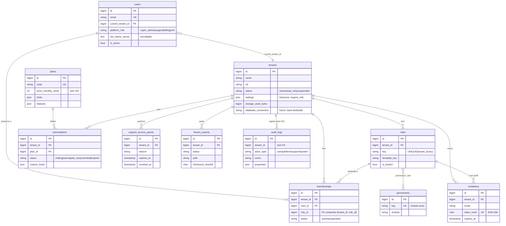

# C. Modelo relacional de dados

Duas partes: (1) o esquema **implementado** na fase 1, com migrações e testes; (2) o modelo **lógico completo** do produto, que orienta as fases seguintes. As tabelas da parte 2 ainda não existem.

## Convenções

- Chaves primárias `id BIGINT UNSIGNED AUTO_INCREMENT`.
- Todas as tabelas com dados de empresa têm `tenant_id` (FK para `tenants`) e usam o trait `BelongsToTenant`.
- Unicidade sempre com `tenant_id` à cabeça (ex.: `UNIQUE(tenant_id, code)`).
- Relações críticas dentro da empresa usam **FK composta** `(tenant_id, x_id) → x(tenant_id, id)`, com `UNIQUE(tenant_id, id)` na tabela de destino.
- `created_at`/`updated_at` em todas as tabelas; `deleted_at` (soft delete) onde há obrigação de histórico.
- Estados como `VARCHAR(20)` + enum PHP (evita `ALTER TABLE` para acrescentar estados).
- Valores monetários em cêntimos (`BIGINT`), quantidades em `DECIMAL(14,3)`.
- JSON só para configuração e metadados, nunca para dados que precisem de filtros ou relações.
- Charset `utf8mb4`, colação `utf8mb4_unicode_ci`.

## 1. Esquema implementado (fase 1)

### Tabelas e regras

| Tabela | Âmbito | Notas | Eliminação |
| --- | --- | --- | --- |
| `users` | Global | Identidade. Password com bcrypt. Segredos 2FA encriptados com `APP_KEY` | Manual; associações em cascata |
| `tenants` | Global | Empresa. `status` controla acesso. `deleted_at` (soft delete) | Soft delete; purga em procedimento próprio |
| `plans` | Global | Editável no backoffice. Nunca apagado | `RESTRICT` a partir de `subscriptions` |
| `subscriptions` | Global (gerida pela plataforma) | Histórico: a mais recente é a atual | Cascata com a empresa |
| `permissions` | Global | Sincronizada a partir de `PermissionRegistry` | — |
| `roles` | Empresa | Copiados de `RoleTemplates`. `admin` bloqueado | Cascata com a empresa; app impede apagar perfis em uso |
| `permission_role` | Empresa (via perfil) | Pivô | Cascata |
| `memberships` | Empresa | `UNIQUE(tenant_id, user_id)`; FK composta para o perfil | Cascata com empresa ou utilizador |
| `invitations` | Empresa | Só o hash do token; validade 7 dias | Cascata |
| `audit_logs` | Empresa ou plataforma | Append-only; sem FK para sobreviver à remoção de utilizadores | Por política de retenção |
| `support_access_grants` | Empresa | Máx. 72 h, só leitura | Cascata |
| `tenant_exports` | Empresa | Ficheiro expira em 48 h | Cascata; ficheiro apagado por comando agendado |
| `sessions`, `cache*`, `jobs`, `failed_jobs`, `password_reset_tokens`, `personal_access_tokens` | Infraestrutura Laravel | Necessárias em cPanel (drivers em BD) | Limpeza agendada |

### Índices principais

- `memberships(user_id, status)` — resolução da empresa ativa em cada pedido.
- `audit_logs(tenant_id, created_at)` — listagem da auditoria por empresa.
- `subscriptions(tenant_id, status)` e `(status, trial_ends_at)` — varrimento diário.
- `invitations(token_hash)` único — aceitação de convites.

## 2. Modelo lógico completo (fases 2 a 6)

Todas as tabelas abaixo levam `tenant_id`, `created_at`, `updated_at` e, quando indicado, `created_by_user_id`.

### Estrutura da empresa (fase 2)

| Tabela | Campos principais | Relações |
| --- | --- | --- |
| `departments` | name | — |
| `cost_centers` | code, name, parent_id | auto-relação |
| `work_calendars` | name, weekly_hours (JSON por dia) | — |
| `holidays` | calendar_id, date, name, scope (nacional/municipal) | calendário |
| `clients` | type (particular/empresa/público), name, nif, contactos | — |
| `specialties` | code, name (estruturas, AVAC, eletricidade...) | — |

### Obras (fase 2)

| Tabela | Campos principais | Relações |
| --- | --- | --- |
| `projects` | code, name, client_id, owner_name, type, address, lat, lng, contract_value_cents, initial_budget_cents, starts_on, planned_end_on, contract_days, status, deleted_at | cliente |
| `project_members` | project_id, membership_id, role_id (perfil na obra) | FK compostas |
| `project_contract_revisions` | project_id, number, value_delta_cents, days_delta, reason, approved_at | obra |
| `buildings` → `floors` → `zones` | project_id / building_id / floor_id, name, sort_order | hierarquia |
| `construction_elements` | zone_id, element_type (sapata, pilar, viga, laje, parede...), code, name, specialty_id | zona |
| `activities` | project_id, element_id (opcional), wbs_code, name, unit, planned_qty, status | elemento |
| `activity_dependencies` | predecessor_id, successor_id, type (FS/SS/FF/SF), lag_days | atividades |
| `schedules` | project_id, version, is_baseline, created_at | obra |
| `schedule_items` | schedule_id, activity_id, start, finish, optimistic/likely/pessimistic (PERT), is_critical, float_days | versão |
| `site_diary_entries` | project_id, date, weather (JSON), notes, submitted_at, submitted_by | obra; `UNIQUE(project_id, date)` |
| `site_diary_items` | entry_id, kind (equipa, equipamento, material, incidente, visita), payload JSON | diário |

### Documentos e media (fase 2)

| Tabela | Campos principais |
| --- | --- |
| `folders` | project_id, parent_id, name |
| `documents` | project_id, folder_id, title, specialty_id, current_version_id, tags (via pivô) |
| `document_versions` | document_id, number, disk, path, size, mime, sha256, uploaded_by, antivirus_status |
| `media` | project_id, kind (foto/vídeo), original_path, preview_path, sha256, taken_at, gps (opcional), exif JSON |
| `attachables` | media_id/document_id, attachable_type, attachable_id (liga a tarefas, inspeções, ocorrências, elementos) |
| `download_logs` | document_version_id, user_id, ip, created_at |

O original de cada fotografia é guardado sem alterações (hash SHA-256 registado) e as versões otimizadas ficam noutro caminho.

### Fiscalização e qualidade (fase 3)

| Tabela | Campos principais |
| --- | --- |
| `checklist_templates` | name, specialty_id, version, is_active |
| `checklist_template_items` | template_id, text, requires_photo, requires_measure, is_hold_point |
| `inspections` | project_id, element_id, activity_id, template_id, status (9 estados), requested_by, inspector_membership_id, scheduled_for, remote |
| `inspection_items` | inspection_id, template_item_id, result (ok/nok/na), measure_value, notes |
| `inspection_decisions` | inspection_id, decision, decided_by, reason, signature_ref, prev_hash, hash (cadeia imutável) |
| `evidence_requirements` | template_item_id, kind, min_count, orientation_hint |
| `evidence_scores` | inspection_id, score, criteria JSON (índice de suficiência, explicável) |
| `hold_points` | activity_id, inspection_id, released_at, released_by |
| `issues` (ocorrências / NC) | project_id, number (`UNIQUE(tenant_id, project_id, number)`), location, specialty_id, description, priority, severity, assignee_membership_id, assignee_subcontractor_id, due_on, status, closed_at, validated_by |
| `issue_events` | issue_id, type (comentário, mudança de estado, escalonamento), payload |
| `approvals` | approvable_type, approvable_id, step, approver_membership_id, decision, decided_at |
| `comments` | commentable_type, commentable_id, body, author_id |

### Gestão económica (fase 4)

| Tabela | Campos principais |
| --- | --- |
| `budgets` | project_id (opcional), code, name, version, status, vat_mode, overhead_pct, profit_pct |
| `budget_chapters` | budget_id, parent_id, code, name, sort_order |
| `budget_items` | chapter_id, article_id, code, description, unit, quantity, unit_price_cents, total_cents |
| `articles` (biblioteca) | code, description, unit, composed (bool), source, license_note |
| `article_components` | article_id, resource_type (material/mão de obra/equipamento/subempreitada), resource_id, yield, unit_cost_cents |
| `materials`, `labor_categories`, `equipment` | code, name, unit, cost_cents, price_history via `price_records` |
| `measurements` | project_id, budget_item_id, element_id, formula JSON (dimensões, desperdício, fator), quantity |
| `measurement_certificates` (autos) | project_id, contract_id, number, period, status, total_cents, approved_at |
| `measurement_certificate_lines` | certificate_id, budget_item_id, qty_period, qty_accumulated, amount_cents |
| `suppliers`, `subcontractors` | name, nif, specialties, documents com validade |
| `contracts` | project_id, party_type, party_id, value_cents, retention_pct, starts_on, ends_on |
| `purchase_orders`, `purchase_order_lines` | supplier_id, project_id, status, expected_on |
| `cost_entries` | project_id, cost_center_id, specialty_id, source_type/source_id, kind (previsto/comprometido/realizado), amount_cents, date |
| `workers` | membership_id (opcional), name, nif (encriptado), hourly_cost_cents, subcontractor_id |
| `time_entries` | worker_id, project_id, activity_id, date, start, end, break_min, type (normal/extra), approved_by, geo (opcional e configurável) |
| `equipment_usage`, `maintenance_records` | equipment_id, project_id, hours, cost |

### Inteligência e automação (fase 5)

| Tabela | Campos principais |
| --- | --- |
| `ai_usage` | user_id, feature, provider, model, tokens_in, tokens_out, cost_micros, created_at |
| `ai_document_chunks` | document_version_id, chunk_index, content_hash, embedding_ref (vetores fora do MySQL se necessário) |
| `automation_rules` | trigger, conditions JSON, actions JSON, is_active |
| `notifications` (Laravel) + `notification_preferences` | canal, frequência, limites de envio |

### Comercialização e integrações (fase 6)

| Tabela | Campos principais |
| --- | --- |
| `coupons`, `coupon_redemptions` | code, percent_off/amount_off, max_redemptions, valid_until |
| `invoices` (subscrições) | tenant_id, number externo (software certificado), amount_cents, status, paid_at |
| `payment_methods` | provider, provider_ref (sem dados de cartão) |
| `integrations` | provider, status, credentials (encriptado), settings |
| `webhooks`, `webhook_deliveries` | url, secret (encriptado), events, last_status |
| `platform_announcements` | title, body, audience, starts_at, ends_at |
| `support_tickets` | tenant_id, subject, status, priority |

## 3. Retenção (proposta, a validar juridicamente)

| Dados | Retenção proposta |
| --- | --- |
| Auditoria | 5 anos (segurança e prova); purga anual do que excede |
| Logs técnicos | 14 dias |
| Exportações | 48 h |
| Convites aceites/expirados | 12 meses |
| Empresa cancelada | 90 dias em só leitura/exportável, depois eliminação definitiva com registo |
| Fotografias e documentos de obra | Enquanto a empresa estiver ativa + período de garantia da obra (definido pela empresa) |
