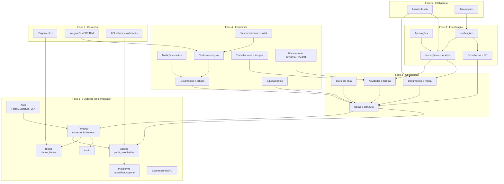

# D. Estrutura de módulos e dependências



## Regras de dependência

1. Todo o módulo de negócio depende de **Tenancy** (dados por empresa) e **Access** (permissões). Nenhum módulo consulta dados de outra empresa.
2. Módulos comunicam por **eventos de domínio** quando não precisam de resposta imediata (ex.: `InspectionApproved` → Notificações, Custos). Evita acoplamento circular.
3. **Billing** é consultado através de `PlanLimits` (`assertCanAdd`, `hasFeature`) e nunca acede aos dados dos módulos diretamente: cada módulo regista o seu contador.
4. **Audit** é transversal: qualquer módulo chama `Auditor::record`.
5. **Exportação**: cada módulo regista a sua secção em `TenantDataExporter`.
6. **Permissões**: cada módulo acrescenta as suas chaves em `PermissionRegistry` e o comando `obraconnect:sync-permissions` junta-as aos perfis-modelo.

## Pontos de extensão já preparados

| Extensão | Onde | Usado a partir de |
| --- | --- | --- |
| Contador de limite do plano | `PlanLimits::registerCounter()` | Fase 2 (`max_active_projects`) |
| Secção de exportação | `TenantDataExporter::registerSection()` | Fase 2 |
| Permissão por obra | `AccessResolver::can($membership, $perm, $project)` | Fase 2 |
| Funcionalidade por plano | `PlanLimits::hasFeature($tenant, 'inspections')` | Fase 3 |
| Base de dados dedicada | `tenants.database_connection` | Fase 6 |

## Frontend

```
resources/js/
  api/            cliente HTTP (cookies Sanctum), tipos, endpoints por módulo
  stores/         sessão (utilizador, empresa ativa, permissões), notificações
  router/         rotas e guardas (autenticação, 2FA, permissões, plataforma)
  components/ui/  botões, campos, tabelas, modais, alertas
  components/layout/  shell (modo escritório), troca de empresa
  pages/auth|app|platform/
```

O **modo obra** (interface simplificada para telemóvel com ações rápidas) entra na fase 2 como um segundo layout (`FieldShell`) sobre os mesmos módulos.
